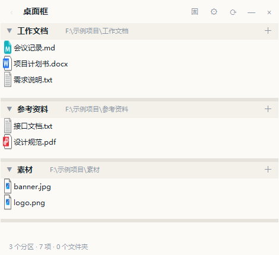

# 桌面框 · Desktop Frame

<p align="center">
  
</p>

<p align="center">
  
  
  
  
</p>

**一个停在 Windows 桌面上的文件悬浮框。** 把 D / E / F 盘里常用的几个文件夹钉在桌面层：桌面之上、其它窗口之下，文件始终留在原来的盘里，不复制、不搬家、不占 C 盘空间。

整个程序就是**一个 PowerShell 脚本**（约 3600 行）加一个启动器，零第三方依赖、免安装、不需要管理员权限、不联网。

<details>
<summary><b>English</b>（Summary）</summary>

A lightweight floating file panel that stays **above the desktop but below other windows** on Windows. Pin your frequently used folders (on any drive) as collapsible sections with full Explorer-style operations: open / cut / copy / paste / rename / recycle-bin delete / new folder / copy full path / properties / share, plus third-party shell extensions. Drag files out to other apps (copy), drag files in to copy them into the section's folder. Single-file PowerShell (WinForms), no dependencies, no admin rights, no network. Optional auto-start on login that restores your last state.

</details>

---

## 目录

- [功能特性](#-功能特性)
- [环境要求](#-环境要求)
- [安装](#-安装)
- [使用方法](#-使用方法)
- [配置文件](#️-配置文件说明)
- [目录结构](#-目录结构)
- [常见问题](#-常见问题)
- [技术实现](#-技术实现)
- [参与贡献](#-参与贡献)
- [许可证](#-许可证)

---

## ✨ 功能特性

### 📁 文件操作（和资源管理器同一套习惯）

| 功能 | 说明 |
|---|---|
| 打开 / 进入 | 双击文件用默认程序打开；双击文件夹进入该层，框顶部出现返回箭头 |
| 剪切 / 复制 / 粘贴 | 与资源管理器互通：在框里复制，可以去资源管理器里粘贴，反之亦然 |
| 重命名 / 删除 | 删除进**回收站**，不直接彻底删除；重命名自动保留扩展名 |
| 新建文件夹 | 每个分区标题右侧有「＋」按钮，也可以用右键菜单 |
| 复制完整路径 | 一键把选中项的完整路径放进剪贴板（支持多选） |
| 属性 / 打开方式 / 共享 | 与系统一致；「打开方式」走系统选择器 |
| 第三方右键菜单 | 装了 WinRAR、360 压缩、批量重命名等软件，它们的动词会自动出现在**「更多选项」**子菜单里（实时读取系统注册的 shell 动词，不写死） |
| 拖出去 | 选中文件拖到微信、浏览器、压缩软件等 = **复制**过去 |
| 拖进来 | 从资源管理器把文件 / 文件夹拖进某个分区 = 复制到该分区所在目录（拖到自己所在的目录则什么都不做，防误触） |

### 🪟 窗口体验

| 功能 | 说明 |
|---|---|
| 桌面层级 | 默认停在**桌面之上、其它窗口之下**：不挡你正在用的软件，又随时能看见。也可以在右键菜单勾「窗口置顶」 |
| 无级透明 | 设置里 40%–100% 拉滑块；右键菜单里也能「更透明一点 / 更不透明一点」微调 |
| 背景外观 | 设置 →「外观」：点「背景颜色」选任意底色，或「背景图…」挑一张图。文字颜色按背景深浅自动切成深色 / 浅色 |
| 收起 / 展开 | 收起后只剩一条 42px 的标题栏，再点一下原样还原 |
| 八向缩放 | 窗口无边框，沿四边、四角都有隐形手柄，最小 420×200 |
| 固定 | 点「固」锁住窗口位置，防止手滑拖歪；固定状态下**仍然可以**拉边改大小、拖分区横条改高度 |
| 单实例 | 重复双击启动器不会开第二个，只是让窗口显示 / 隐藏切换 |

### 🗂 分区管理

| 功能 | 说明 |
|---|---|
| 多来源 | 每个文件夹是一块独立分区，块头显示名称和完整路径 |
| 折叠 / 展开 | 点分区标题折叠成一条，再点展开 |
| 一键收放 | 点标题栏的 `⊟` 把所有分区的内容一起收起来（只剩块头），再点 `⊞` 全部展开 |
| 自定义高度 | 拖分区之间那条 6px 细横线改高度；松手记住，重启还原 |
| 自适应高度 | 没拖过的分区按内容自适应，最多露 16 行，其余在分区内部滚动 |
| 图标 | 文件类型图标真实读取系统 shell 图标 |

### ⚙️ 其它

| 功能 | 说明 |
|---|---|
| 开机自动启动 | 设置里勾选即可（只写当前用户的启动项，不需要管理员权限） |
| 状态恢复 | 关闭时的窗口位置 / 大小 / 透明度 / 来源列表 / 固定状态 / 各分区高度，下次启动（含开机自启）全部还原 |
| 隐藏文件 | 设置里决定是否显示隐藏文件 |
| 托盘图标 | 双击托盘图标 = 显示 / 隐藏窗口 |

---

## 🖥 环境要求

| 项目 | 要求 |
|---|---|
| 系统 | Windows 10 / 11 |
| PowerShell | 5.1（系统自带，无需安装任何运行库） |
| 权限 | 普通用户即可，**不需要管理员** |
| 网络 | 完全不联网 |

---

## 📦 安装

### 方式一：下载打包版（推荐，适合只用不研究）

1. 打开本仓库的 **Releases** 页面，下载 `桌面框_v1.0.zip`；
2. 右键压缩包 → **属性 → 勾选「解除锁定」→ 确定**（Windows 会给网上下载的文件打标记，不解锁双击可能被拦）；
3. 解压到任意位置，比如 `D:\桌面框`（**不要**放进 `C:\Program Files`，那里普通权限改不了配置文件）；
4. 双击文件夹里的 **`启动桌面框.vbs`**。

> 想要桌面图标：双击 `tools\install.bat`，会在桌面创建一个「桌面框」快捷方式。不建也行，直接双击 vbs 一样用。

### 方式二：克隆本仓库（适合想看 / 改代码）

```bat
git clone https://github.com/puxin001/desktop-frame.git
cd desktop-frame
启动桌面框.vbs
```

代码克隆下来就能直接跑，无需构建步骤。

### 首次启动

第一次打开会**自动弹出设置窗口**：

1. 点「添加目录」→ 选一个常用文件夹（可以加多个）；
2. 需要的话拖一下「背景不透明度」；
3. 想开机自启就勾上「开机自动启动（恢复上次关闭时的状态）」；
4. 点「保存并关闭」。

之后的所有设置程序都会自己记住。不想要了：点右上角 `×` 退出，删掉整个文件夹即可，不会在系统里留垃圾（唯一可能留下的痕迹是你自己勾选的开机自启，取消勾选即清除）。

---

## 📖 使用方法

### 界面总览

```
┌──────────────────────────────────────────┐
│ 桌面框                    ⊟  固  ⚙  ⟳  —  × │  ← 标题栏（可拖动挪位置）
├──────────────────────────────────────────┤
│ ▼ 工作文档     D:\资料\工作文档        ＋ │  ← 分区头（点击折叠/展开）
│   📄 会议记录.md                           │
│   📄 项目计划书.docx                       │     ＋ = 新建文件夹
│   📄 需求说明.txt                          │
├──────────────────────────────────────────┤
│ ▼ 参考资料     D:\资料\参考资料        ＋ │  ← 分区之间那条线可以拖动改高度
│   📄 设计规范.pdf                          │
├──────────────────────────────────────────┤
│  2 个分区 · 5 项 · 0 个文件夹               │  ← 状态栏（选中文件时显示大小/修改时间）
└──────────────────────────────────────────┘
```

**标题栏按钮（从右往左）**

| 按钮 | 作用 |
|---|---|
| `×` | 退出程序 |
| `—` / `▣` | 收起 / 展开（收起后只剩标题栏） |
| `⟳` | 刷新当前目录 |
| `⚙` | 设置：来源目录、背景不透明度、开机自动启动、打开配置文件 |
| `固` | 固定：锁住窗口位置（固定后仍可拉边改大小、拖分区横条改高度） |
| `⊟` / `⊞` | 一键收放：`⊟` 收起所有分区的内容（只留块头），`⊞` 全部展开。图标画的是「按下去会做什么」 |

### 基本操作

| 操作 | 效果 |
|---|---|
| 单击文件 | 选中；左下角显示它的大小和修改时间 |
| 双击文件 | 用默认程序打开 |
| 双击文件夹 | 进入该层（框顶部出现 `←` 返回箭头，`Backspace` 也能返回） |
| 右键文件 / 文件夹 | 资源管理器同款菜单，见下表 |
| 拖文件到别的程序 | 复制过去（微信、浏览器、压缩软件都能接） |
| 从资源管理器拖进来 | 复制到该分区所在目录 |
| 在文件上滚滚轮 | 文件列表滚动；滚到头自动接着滚整个框 |
| 拖分区之间的横线 | 改这个分区的高度（松手记住） |
| 点分区标题 | 折叠 / 展开该分区 |
| 拉窗口四边 / 四角 | 改窗口大小 |
| 拖标题栏 | 挪窗口位置（「固定」状态下锁死） |

### 右键菜单

| 菜单项 | 说明 |
|---|---|
| 打开 | 用默认程序打开 |
| 打开方式… | 系统的「你要如何打开这个文件」选择器 |
| 在资源管理器中显示 | 跳到资源管理器并选中该文件 |
| 剪切（Ctrl+X） / 复制（Ctrl+C） | 与系统剪贴板互通，支持多选 |
| 粘贴到当前文件夹（Ctrl+V） | 读取剪贴板里的文件；带剪切标记的执行移动 |
| 重命名（F2） | 文件默认只选主名，改完自动补扩展名 |
| 删除（Delete，进回收站） | 走系统回收站，可还原 |
| 新建文件夹 | 在该分区目录里创建 |
| 刷新 | 重新读取目录 |
| 复制文件地址（Ctrl+Shift+C） | 完整路径进剪贴板（多选时一行一条） |
| 属性（Alt+Enter） | 系统属性对话框 |
| 共享… | 调起系统共享向导 |
| **更多选项（系统菜单）** | WinRAR、360 压缩、批量重命名等第三方软件注册的菜单项都在这里，每次打开菜单实时读取 |
| 窗口置顶 | 在「桌面层」和「总是最前」之间切换 |
| 更透明一点 / 更不透明一点 | 步进微调透明度 |

### 快捷键（选中文件后）

| 按键 | 作用 |
|---|---|
| `Enter` | 打开 |
| `Ctrl+C` | 复制 |
| `Ctrl+X` | 剪切 |
| `Ctrl+V` | 粘贴到当前文件夹 |
| `F2` | 重命名 |
| `Delete` | 删除（进回收站） |
| `Ctrl+Shift+C` | 复制完整路径 |
| `Alt+Enter` | 属性 |
| `Backspace` | 返回上一级（进入过子文件夹时） |

### 固定、大小与分区高度

`固` 只做一件事：**锁住窗口位置**，防止手滑把框拖歪。固定状态下：

- 拖标题栏挪窗口 → ❌ 不动
- 拉四边 / 四角改窗口大小 → ✅ 可以
- 拖分区之间的横线改高度 → ✅ 可以
- 其它一切操作 → ✅ 照旧

### 透明度与层级

- 默认「桌面之上、其它窗口之下」：看得到、点得到，但不会盖住你正在用的软件；
- 右键菜单勾「窗口置顶」后变成永远最前（写进配置，重启保持）；
- 透明度在设置里 40%–100% 连续可调，右键菜单里可以 ±微调。

### 开机自动启动

⚙ 设置 → 勾选「**开机自动启动（恢复上次关闭时的状态）**」→ 保存并关闭。

- 只在当前用户的启动项（`HKCU\...\Run`）里加一条，不需要管理员权限；
- 启动命令就是你双击的那条 `wscript.exe 启动桌面框.vbs`，不会闪黑框；
- 启动后按上次关闭时的样子还原：窗口位置、大小、透明度、来源列表、固定状态、各分区高度；
- 以后整个文件夹挪了位置不用管：程序启动时会自动把启动项里的路径改成新位置；
- 取消：同样进设置取消勾选即可。

---

## ⚙️ 配置文件说明

所有设置都在 `app\config.json`，程序自动读写（退出时落盘，改窗口大小 / 固定状态时即时保存）。手工编辑也可以，改坏了删掉它，下次启动会自动重建。

```jsonc
{
  "title": "桌面框",
  "sources": [                                  // 分区列表（name 只用于显示）
    { "name": "工作文档", "path": "D:\\资料\\工作文档" }
  ],
  "window": {
    "x": 160, "y": 120, "width": 580, "height": 460,
    "topmost": false,                           // 是否总是最前
    "zorder": "desktop",                        // desktop = 桌面之上、其它窗口之下
    "opacity": 0.78,                            // 0.4 ~ 1.0
    "locked": false,                            // 「固」按钮的状态
    "bgColor": "#1F2933",                       // 自定义背景色（空字符串 = 默认米白）
    "bgImage": "D:\\Pictures\\wall.png",           // 背景图路径（空字符串 = 不用图）
    "blockHeights": [                           // 各分区被手动拖成的高度
      { "path": "D:\\资料\\工作文档", "h": 260 }
    ]
  },
  "view": {
    "showHidden": false,                        // 是否显示隐藏文件
    "iconSize": 48
  }
}
```

---

## 📁 目录结构

```
desktop-frame/
├─ 启动桌面框.vbs        双击启动（内部转手去跑 ps1，全程不弹黑框）
├─ 使用说明.txt          面向使用者的完整说明（与本文内容互补）
├─ app/
│  ├─ desktop_box.ps1    程序本体：全部逻辑都在这一个文件里
│  └─ config.json        你的设置（程序自动读写）
├─ tools/
│  ├─ install.bat        可选：在桌面创建快捷方式
│  ├─ create_shortcut.ps1  上面那个的实际逻辑
│  ├─ check.ps1          环境自检：出问题时逐项排查
│  └─ make_box.ps1       早期备选方案（桌面真实文件夹 + 目录联接），
│    run_make_box.bat      与本程序二选一，别同时用（都会占用「桌面框」这个名字）
└─ docs/screenshot.png
```

---

## ❓ 常见问题

**双击 vbs 没反应，或弹「Windows 已保护你的电脑」？**
从网上下载的文件会被 Windows 打标记。右键压缩包（或解压后的 vbs）→ 属性 → 勾选「解除锁定」→ 确定，再试。

**双击后什么都没出现？**
程序是单实例：已经在运行时，再启动一次只是让窗口显示 / 隐藏。去右下角托盘看看有没有图标，双击它。

**提示找不到 `app\desktop_box.ps1`？**
文件没拷全。整个文件夹要一起拿，不能只复制 vbs。

**会占 C 盘空间吗？会动我的文件吗？**
都不会。程序只是把目录列出来，所有增删改都发生在文件原来的位置。

**分区里文件太多会卡吗？**
所有条目都会列出来；分区默认按内容自适应高度、最多露 16 行，其余在分区内滚动。可以拖高分区，也可以折叠不常看的。

**想彻底退出？**
右上角 `×`，或托盘图标右键 → 退出。

**出问题怎么排查？**
双击 `tools\check.ps1`（或右键 → 使用 PowerShell 运行）逐项体检；启动就崩的原因会写在 `app\error.log` 里。

---

## 🛠 技术实现

- **纯 PowerShell 5.1 + WinForms**，无第三方库、无安装包；整个程序是一个脚本。
- 无边框窗口自己实现：四边四角铺透明手柄做八向缩放，`WM_NCHITTEST` 之外全部手工处理。
- 「桌面之上、其它窗口之下」通过窗口 `z-order` 排序实现，不用 `TopMost`，所以不会挡别的程序的对话框。
- 第三方右键菜单通过 `Shell.Application` 的 `Verbs()` 实时读取，不枚举注册表、不写死任何软件名。
- 文件删除走 `Microsoft.VisualBasic.FileIO` 的回收站接口，绝不直接删。
- 开机自启只写 `HKCU\Software\Microsoft\Windows\CurrentVersion\Run`，程序挪窝后下次启动自动校正路径。
- 自带 37 项自检（`-SelfCheck` 参数），覆盖布局、滚轮转发、拖放、配置往返、启动项读写等关键路径。

欢迎 Issue / PR。改代码前可以先跑一遍自检确认基线是绿的：

```powershell
powershell -NoProfile -STA -ExecutionPolicy Bypass -File .\app\desktop_box.ps1 -SelfCheck
```

---

## 📄 许可证

[MIT](LICENSE) —— 可以自由使用、修改、分发。

**免责声明**：本程序按「现状」提供。它只对文件做常规的打开 / 复制 / 移动 / 回收站删除等操作，但请照常做好重要文件的备份；作者不对使用本软件造成的任何数据损失承担责任。
